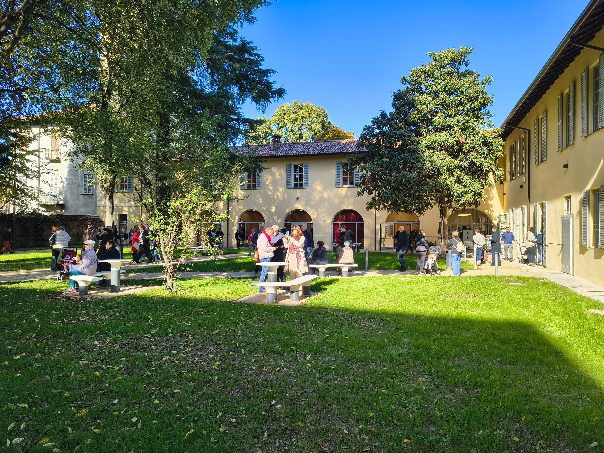
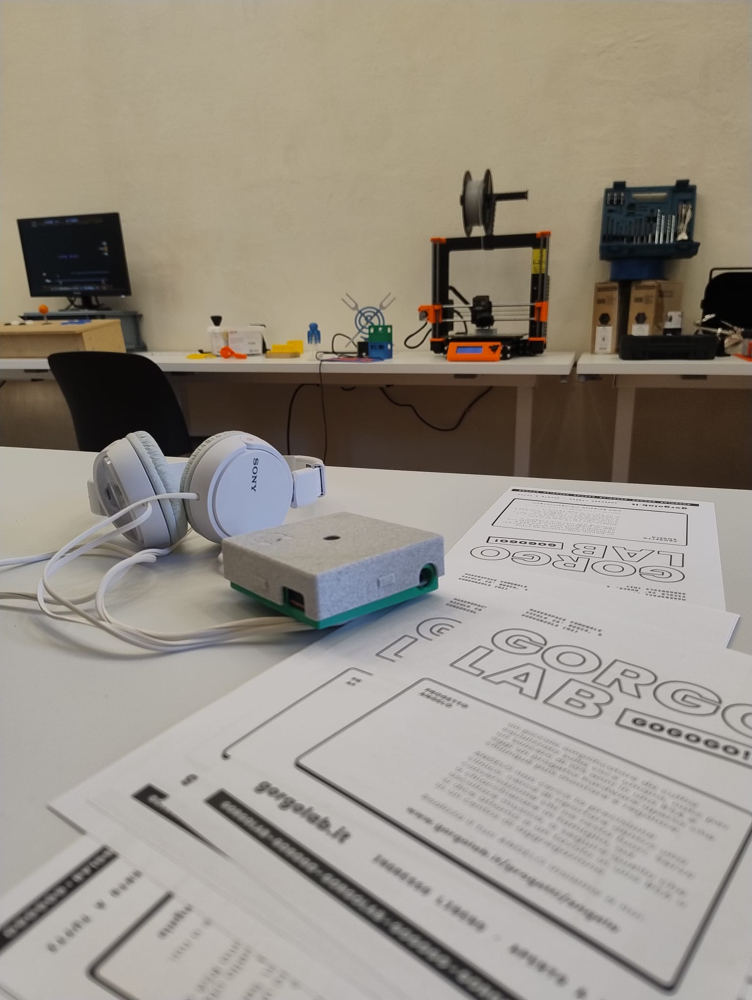
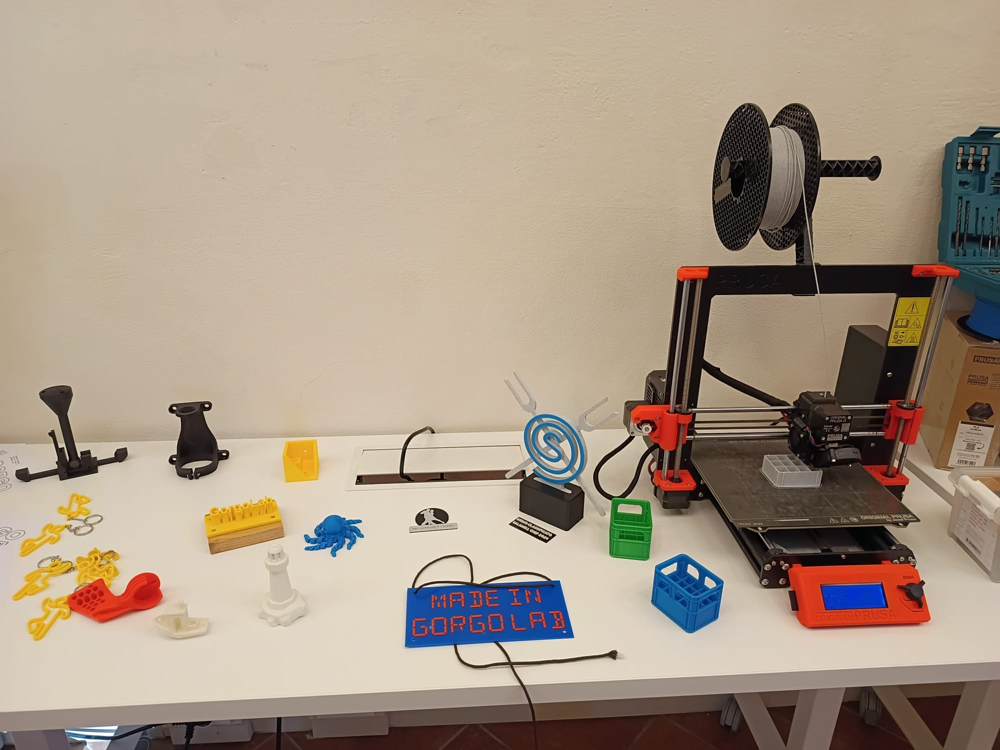
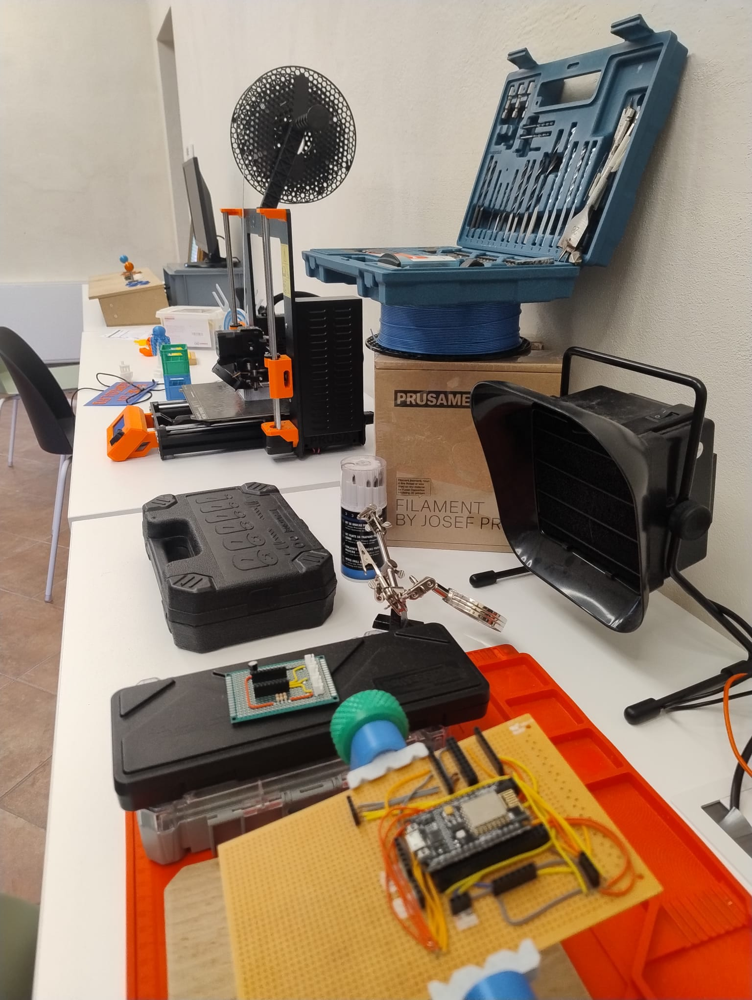

Sabato 24 ottobre Ca' Busca ha aperto le porte alla città. Il complesso storico
di via Montenero, appena restituito a Gorgonzola, ora ospita sale
studio, spazi per gli eventi, le politiche giovanili e i laboratori. Uno di
questi laboratori è il nostro.

Per l'inaugurazione abbiamo deciso di non limitarci a raccontare cos'è un
makerspace: abbiamo preferito farlo vedere. Abbiamo apparecchiato la sala come
una vetrina, con i progetti finiti su un lato e gli attrezzi accesi sull'altro,
e abbiamo lasciato le cose a portata di mano. Chi passava poteva prendere in
mano i pezzi, osservarli e chiedere come funzionano.

## I progetti in vetrina

Sui tavoli c'era una parte di quello che è passato dai nostri banchi:

- **[ANGELO](/progetti/angelo/)**, l'amplificatore da cuffia equalizzato sulla
  voce umana, nato per un signore di 105 anni ma che ora aiuta molti altri anziani
  e non solo. L'abbiamo messo a disposizione per chiunque volesse provarlo;
- **[l'orto in cassetta](/progetti/orto-in-cassetta/)** di Gorgoglìo, con
  l'insalata che cresce nell'acqua senza terra, sul terrazzo di molti gorgonzolesi;
- **[il Mamecab](/progetti/mamecab/)**, l'arcade stick di legno collegato a un
  monitor: è stato il pezzo più conteso della giornata;
- **una cornice LED**, una cornice dorata da quadro antico con dentro una
  matrice di pixel colorati al posto della tela, per far giocare i bambini;
- **Space Invaders in 1D**, il classico da sala giochi ridotto a una sola
  striscia di luce. È la dimostrazione che un'idea strampalata, portata fino in
  fondo, diventa un gioco vero.

Nessuno di questi oggetti si compra in negozio, ed è proprio questo il punto.
Ciascuno è nato da un'esigenza, da una curiosità o da una scommessa, e ha preso
forma un pezzo alla volta, con parecchi tentativi buttati lungo la strada.

## Gli attrezzi, accesi

Dall'altra parte della sala c'erano le macchine: il **trapano a colonna**, la
**stazione saldante**, gli **attrezzi per lavorare il legno** e la **stampante
3D**, circondata da oggetti stampati che si potevano prendere e rigirare fra le
dita.

La stampante ha raccolto la sua solita piccola folla. Guardare un oggetto che
cresce un millimetro alla volta, strato su strato, ha qualcosa di ipnotico, e
la domanda arriva sempre: *«ma quindi posso stampare quello che voglio?»*. La
risposta onesta è: quasi. Prima però va disegnato, e in quel momento la
stampante smette di essere un giocattolo e diventa uno strumento.

## Cosa abbiamo provato a dire

È stata una bella giornata. Sono passate tante persone, molte delle quali non
avevano mai sentito la parola *makerspace* e se ne sono andate sapendo cos'è.
Più che le macchine, però, ci premeva far passare un'altra idea:

**in un makerspace i protagonisti sono le persone che entrano.**

Gli attrezzi contano, ma un trapano a colonna si trova anche altrove. Qui c'è
anche una comunità: ingegneri, informatici, elettronici, designer, hobbisti,
studenti e pensionati, accomunati dalla voglia di creare, modificare, adattare,
smontare e capire come funzionano le cose dentro. E poi di raccontarlo agli
altri, perché quello che uno scopre al banco serve a chi arriva dopo.

È lo stesso motivo per cui esiste questo sito: ogni progetto documentato è un
progetto che qualcun altro può rifare, correggere o migliorare.

Per questo non serve arrivare con un progetto già pronto. Basta un'idea, una
curiosità o un problema da risolvere: la lampada che non si accende più, il
pezzo di plastica rotto che non si trova come ricambio, la cosa che ti
piacerebbe costruire e che non sai da dove cominciare. Il resto lo si capisce
insieme.

## E adesso?

Adesso tocca a voi. Il **mercoledì sera, dalle 20:30**, il lab è aperto a
tutti: si entra senza prenotare, si guarda a che punto sono i progetti e si fa
qualche domanda. Gli orari completi e le regole per usare le macchine sono nella
pagina [Lo spazio](/spazio/). Se invece avete già qualcosa da raccontare, la
pagina [Contribuire](/contribuire/) spiega come pubblicarlo qui.

Grazie a chi è passato sabato, a chi ha fatto domande difficili e a chi ha
giocato al Mamecab più a lungo del previsto. Vi aspettiamo al banco.
